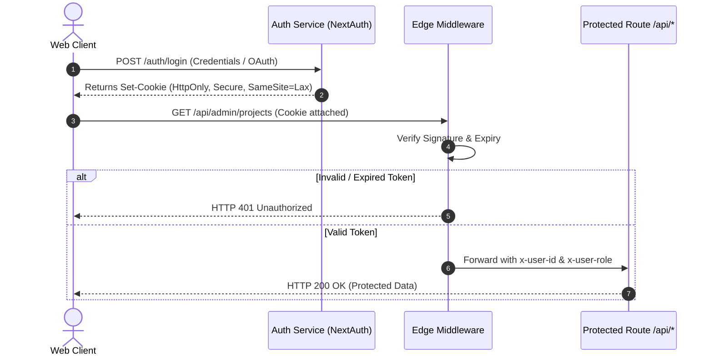

# Authentication & Security

## 🔐 Authentication Paradigms

ACR services implement a dual-tier authentication architecture depending on client classification:

1. **API Key Authentication (`X-API-Key`):** For server-to-server microservices, CI/CD runners, and automated scripts.
2. **Bearer Token Authentication (`Authorization: Bearer <JWT>`):** For user sessions, admin portals, and interactive client applications.

---

## 🔑 1. API Key Authentication

Include your secret API key in the `X-API-Key` HTTP header:

```http
GET /v1/projects HTTP/1.1
Host: api.adicahyadir.dev
X-API-Key: acr_live_89a3f9024f9e11894a7cb
```

> **Security Notice:**  
> Never commit API keys to client-side bundles or public GitHub repositories. Use `.env.local` for local development.

---

## 🛡️ 2. JWT & Session Workflow

Interactive web applications rely on signed JSON Web Tokens (JWT) minted via NextAuth or Supabase Auth with HMAC SHA-256 (`HS256`) or RSA (`RS256`).



---

## 👥 Role-Based Access Control (RBAC)

Every authenticated identity contains a declarative `role` claim:

| Role | Access Scope | Capabilities |
| :--- | :--- | :--- |
| **`public`** | Read-Only | Browse public projects, view docs, submit contact forms. |
| **`contributor`** | Read / Draft | Propose project updates, create draft articles, comment. |
| **`admin`** | Full Read/Write | Deploy updates, manage secrets, mutate records, flush caches. |

### Enforcing Roles in Middleware

```typescript
// middleware.ts - Edge RBAC Protection
import { NextResponse, type NextRequest } from 'next/server';
import { verifyJwt } from '@/lib/auth/jwt';

export async function middleware(req: NextRequest) {
  const token = req.cookies.get('acr_session')?.value;

  if (req.nextUrl.pathname.startsWith('/api/admin')) {
    if (!token) {
      return NextResponse.json(
        { status: 'error', error: { code: 'UNAUTHORIZED', message: 'Authentication required' } },
        { status: 401 }
      );
    }

    const payload = await verifyJwt(token);
    if (!payload || payload.role !== 'admin') {
      return NextResponse.json(
        { status: 'error', error: { code: 'FORBIDDEN', message: 'Insufficient administrative privileges' } },
        { status: 403 }
      );
    }
  }

  return NextResponse.next();
}

export const config = {
  matcher: ['/api/admin/:path*'],
};
```

---

## 🔒 Security Best Practices

* **HttpOnly Cookies:** Authentication cookies are marked `HttpOnly`, preventing extraction through Cross-Site Scripting (XSS).
* **SameSite & Secure Flags:** Cookies enforce `SameSite=Lax` and `Secure=true` in production to resist Cross-Site Request Forgery (CSRF).
* **Token Expiration:** Access tokens have an ephemeral TTL of 15 minutes. Refresh tokens possess a 7-day TTL with automated rolling rotation.
