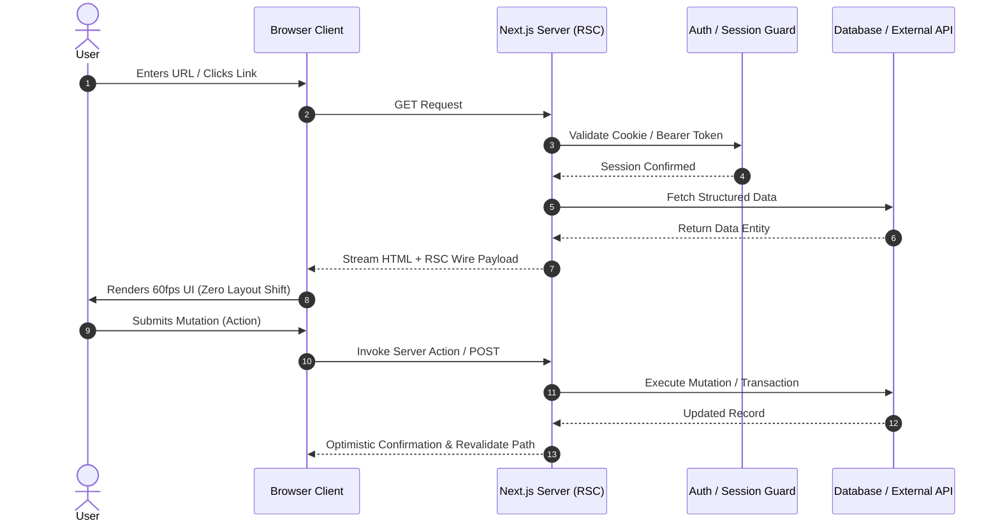

# System Architecture

## 🏛️ High-Level Architectural Overview

Applications in the **ACR** ecosystem adopt a **Modular Fullstack / Server-First Architecture** designed for high throughput, minimal client runtime overhead, and strict type safety across all boundaries.

The architectural pattern decouples presentation, business orchestration, and data persistence layers.

---

## 📊 System Flowchart Diagram

```mermaid
flowchart TD
    subgraph Client["User & Browser Runtime"]
        User(["User Client / Device"])
        BrowserDom["DOM / Canvas Renderer"]
        ClientState["Zustand Client State"]
        User <--> BrowserDom
        BrowserDom <--> ClientState
    end

    subgraph Edge["Edge & CDN Gateway (Vercel / Cloudflare)"]
        EdgeCDN["Edge Cache & Static Assets"]
        Middleware["Edge Middleware / Auth Guards"]
    end

    subgraph AppServer["Application Layer (Next.js)"]
        RSC["React Server Components (RSC)"]
        RouteHandler["Route Handlers (/api/*)"]
        ServerActions["Server Actions (Mutations)"]
        Validation["Zod Schema Validation"]
    end

    subgraph Persistence["Persistence & External Services"]
        Database[("PostgreSQL / Supabase / Redis")]
        AIModel["OpenAI / Gemini / Anthropic API"]
        Storage["Object Storage (S3 / R2)"]
    end

    BrowserDom -->|HTTP / TLS Request| EdgeCDN
    EdgeCDN --> Middleware
    Middleware --> RSC
    BrowserDom -->|Interactive Mutations / Fetch| RouteHandler
    BrowserDom -->|RPC Form Actions| ServerActions
    RouteHandler --> Validation
    ServerActions --> Validation
    Validation --> Database
    Validation --> AIModel
    Validation --> Storage
    RSC -->|Data Fetching (ORM/Query)| Database
    RSC -->|Rendered Virtual DOM Stream| BrowserDom
```

---

## 🧩 Architectural Layers

### 1. Presentation & Interaction Layer
* **React Server Components (RSC):** Handles initial data fetching and executes exclusively on the server, streaming static HTML + minimal JSON payload to the client.
* **Client Islands:** Interactive leaf components (`'use client'`) isolated to buttons, form inputs, animations (Framer Motion), and 3D canvases (Three.js).
* **Design Token Engine:** Tailwind CSS utility variables coupled with Radix UI accessibility primitives.

### 2. Validation & Security Perimeter
* **Edge Middleware:** Validates JWT sessions and rate limits requests before hitting compute nodes.
* **Schema Validation:** Strict runtime boundary validation via **Zod**. Unsanitized user payloads never reach internal business services or database layers.
* **CORS & CSP Headers:** Strict Content Security Policy limiting executable script origins and inline styles.

### 3. Business Logic & Orchestration Layer
* **Route Handlers (`/api/*`):** RESTful endpoints for third-party integrations, webhook ingestion, and mobile/external client access.
* **Server Actions:** Type-safe RPC style mutations invoked directly from React client forms, supporting optimistic updates and native revalidation.
* **Service Modules:** Isolated domain services (e.g., `UserService`, `AnalyticsService`, `AIWorkflowService`) adhering to the Single Responsibility Principle.

### 4. Data & External Integration Layer
* **PostgreSQL / Supabase:** Primary relational storage, utilizing Prisma or Drizzle for type-safe migrations and queries.
* **Redis (Upstash):** Low-latency key-value store used for session caching, transient rate limit counters, and expensive query memoization.
* **AI & External APIs:** External LLMs and vector stores integrated using streaming responses via Web Fetch API.

---

## 🔄 Data Flow Lifecycle

The following diagram illustrates how user requests propagate through the system:



---

## 📁 Repository Directory Architecture

ACR production codebases follow a predictable, domain-driven structure:

```text
src/
├── app/                  # Next.js App Router (Pages, Layouts, API Routes)
│   ├── (marketing)/      # Route Group for Landing & Public Pages
│   ├── (dashboard)/      # Route Group for Protected Applications
│   ├── api/              # Public & Internal API Handlers
│   ├── layout.tsx        # Global Root Layout
│   └── page.tsx          # Home Page Entrypoint
├── components/           # Reusable Component Architecture
│   ├── ui/               # Primitive Design System (Buttons, Cards, Inputs)
│   ├── common/           # Shared Layout Elements (Navbar, Footer, Modals)
│   └── modules/          # Feature-specific Composite Components
├── lib/                  # Shared Utility Libraries & Singletons
│   ├── auth/             # Session & Auth Helpers
│   ├── db/               # Database Client (Prisma / Drizzle)
│   ├── ai/               # AI Engine Client & Prompt Templates
│   └── utils.ts          # General Utility Functions (cn, formatters)
├── hooks/                # Custom React Hooks
├── types/                # Global TypeScript Declarations & Interfaces
└── styles/               # Global CSS & Tailwind Directives
```

---

## 🛡️ Non-Functional Requirements & Design Principles

* **Scalability:** Stateless application nodes enabling horizontal auto-scaling on serverless platforms (Vercel, AWS Lambda).
* **Maintainability:** Modularity ensures any domain service or UI component can be replaced without cascading regressions.
* **Observability:** Structured logging with correlation IDs, error monitoring via Sentry, and Web Vitals analytics tracking.
