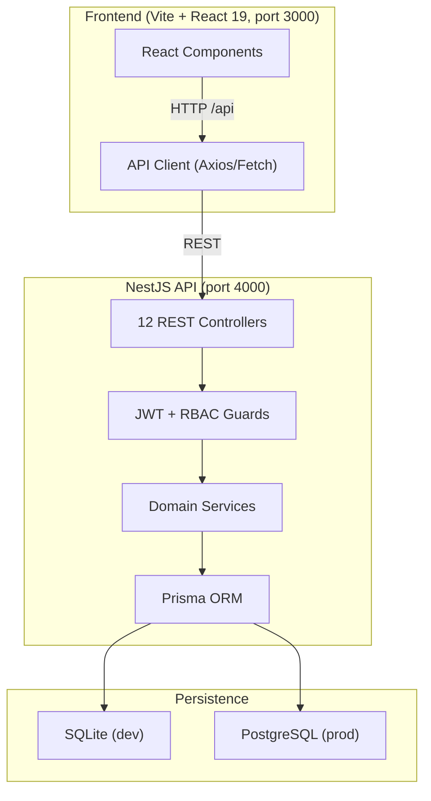
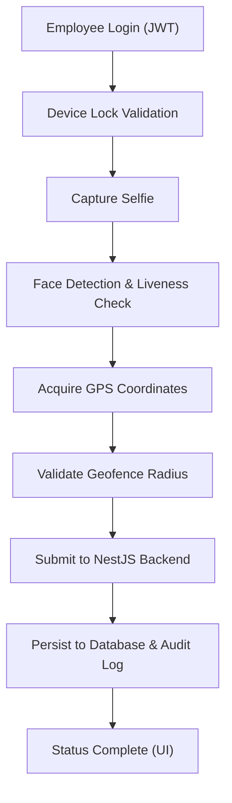

# Sistem Absensi

> **Enterprise smart attendance management system** — monorepo-based PWA-ready platform with NestJS REST API, Prisma ORM, biometric face verification, GPS geofencing, device binding, audit trail, and granular RBAC.

---

## Project Overview

| Attribute | Value |
| :--- | :--- |
| **Purpose** | Multi-branch enterprise attendance management with zero-trust anti-fraud architecture |
| **Domain** | Enterprise HR / Operations |
| **Target Users** | Employees, supervisors, managers, HR, admins, superadmins |
| **Repository** | [github.com/enigmaaura404/absensi_app](https://github.com/enigmaaura404/absensi_app) |
| **License** | MIT |

---

## Key Features

* **Check-in / Check-out**: Biometric face capture, liveness detection & anti-spoofing, GPS geofence validation (Haversine formula), server-side timestamps, single-device lock.
* **Leave & Request Management**: Annual leave, sick leave, personal leave, duty/travel, and attendance correction with multi-tier approval workflow and date overlap protection.
* **Monitoring & Analytics**: Executive dashboard with daily attendance metrics, departmental reports, and CSV/Excel/PDF export.
* **Security & Audit Trail**: Append-only audit log, security event monitoring (impossible travel detection, mock location alerts, biometric mismatches).
* **RBAC**: 6 hierarchical roles with 28 granular permissions.
* **Device Binding**: Per-device fingerprint lock to prevent proxy attendance.
* **Holidays & Shifts**: National holiday calendar and 4 shift configurations (regular, morning, evening, overnight).

---

## Technology Stack

| Layer | Technology | Version |
| :--- | :--- | :--- |
| **Monorepo** | PNPM Workspaces | - |
| **Frontend** | React | 19 |
| **Language** | TypeScript | 5.4+ |
| **Build Tool** | Vite | 8 |
| **Styling** | Tailwind CSS | 4 |
| **Animation** | Motion / Framer Motion | - |
| **Backend Framework** | NestJS | 10 |
| **Runtime** | Node.js | 18+ (20+ recommended) |
| **ORM** | Prisma | 5.22 |
| **Database** | SQLite (dev) / PostgreSQL (production) | - |
| **Auth** | JWT + Passport | - |
| **Hashing** | bcryptjs | - |
| **Testing** | Vitest (frontend), Jest (backend) | - |
| **Icons** | Lucide | - |

---

## System Architecture

```
absensi_app/
├── apps/
│   ├── api/              # NestJS REST API server (port 4000)
│   │   ├── src/
│   │   │   ├── attendance/   # Check-in/out, history
│   │   │   ├── auth/         # JWT auth, login, guards
│   │   │   ├── employees/    # Employee & profile management
│   │   │   ├── requests/     # Leave, sick, duty, correction
│   │   │   ├── dashboard/    # Role-based statistics
│   │   │   ├── locations/    # Geofence & branch management
│   │   │   ├── devices/      # Device binding
│   │   │   ├── holidays/     # Holiday calendar
│   │   │   ├── audit/        # Forensic audit trail
│   │   │   ├── notifications/ # Notification system
│   │   │   └── settings/     # System settings
│   └── web/              # Vite React frontend (port 3000)
├── packages/
│   ├── database/         # Prisma schema, migrations, seed
│   ├── types/            # Shared DTOs, enums, interfaces
│   ├── config/           # Shared configuration constants
│   └── utils/            # Shared business helpers
└── src/                  # React frontend application
```



---

## Application Workflow



---

## Database & API

* **Database**: Prisma schema with SQLite for development and PostgreSQL for production. Seed data includes 15 users, 177 attendance records, 6 roles with 28 permissions, 4 shifts, 2 geofence locations, and 9 registered devices.
* **API**: 12 NestJS controllers covering attendance, auth, employees, requests, dashboard, locations, devices, holidays, audit, notifications, and settings.
* **Verification script**: `npm run db:verify` runs 15-point relational integrity validation.

---

## Setup & Installation

### Prerequisites

* Node.js `>=18.0.0` (LTS v20+ recommended)
* PNPM `>=8.0.0`
* Git

### Installation

```bash
git clone https://github.com/enigmaaura404/absensi_app.git
cd absensi_app
pnpm install
```

### Environment

Copy `.env.example` to `.env` and configure `DATABASE_URL`, `JWT_SECRET`, and `VITE_API_BASE_URL`.

### Database Setup

```bash
npm run db:generate
npm run db:seed
npm run db:verify
```

### Running

```bash
npm run dev
```

* **Web Portal**: `http://localhost:3000`
* **REST API**: `http://localhost:4000/api`

---

## Testing & Quality

* **Automated tests**: 119 test cases across Vitest (frontend) and Jest (backend).
* **Test coverage**: Leave calculations, approval workflow, geofencing (Haversine), payroll deductions, JWT auth, reporting aggregation, device binding, biometric matching, and time tolerance validation.
* **Type safety**: `npm run lint` runs `tsc --noEmit` across the entire monorepo (zero TypeScript errors target).

```bash
npm test
npm run lint
```

---

## Project Status & Limitations

* **Completed**: Monorepo architecture, Prisma schema + migrations + idempotent seed, NestJS REST API (12 controllers), frontend refactored to consume real API data, anti-fraud & biometrics, zero TypeScript errors, 119 automated tests passing.
* **Planned / Not Yet Implemented**: Push notification (WebPush PWA), multi-company SaaS mode (multi-tenancy).
* **No live demo URL** is provided in the repository documentation.

---

## Repository

[View source code on GitHub](https://github.com/enigmaaura404/absensi_app)
