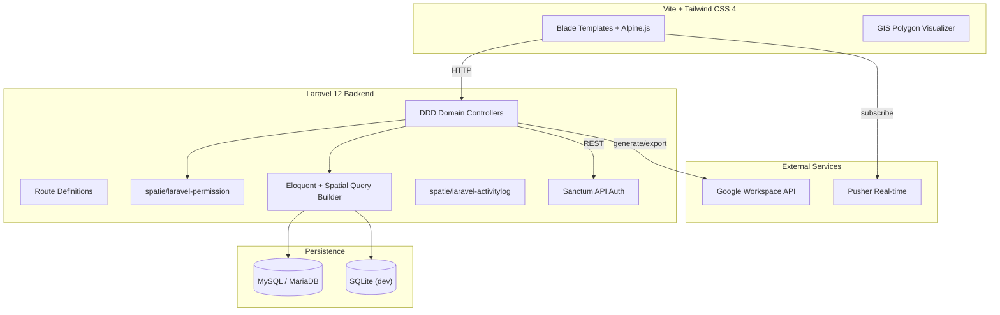

# App Letter C

> **Village land ownership digitalization & spatial information system** — Laravel 12 + Tailwind CSS 4 application with DDD architecture, GIS polygon visualization, and Google Workspace API integration.

---

## Project Overview

| Attribute | Value |
| :--- | :--- |
| **Purpose** | Digital registration of village land ownership (Letter C) with spatial GIS mapping |
| **Domain** | GovTech / Land Administration |
| **Target Users** | Village land registry administrators, residents, and officials |
| **Repository** | [github.com/enigmaaura404/app-letter-c](https://github.com/enigmaaura404/app-letter-c) |
| **License** | MIT |

---

## Key Features

* **Domain-Driven Design (DDD)** architecture for land registration workflows.
* **GIS Polygon Visualization**: Spatial mapping of land parcels using `matanyadaev/laravel-eloquent-spatial`.
* **Google Workspace API Integration**: Document generation and file management via `google/apiclient`.
* **QR Code Generation**: `bacon/bacon-qr-code` for parcel identifiers.
* **Two-Factor Authentication**: `pragmarx/google2fa` for admin security.
* **Activity Logging**: `spatie/laravel-activitylog` for audit trail.
* **Role-Based Access Control**: `spatie/laravel-permission` for granular permissions.
* **Excel Export**: `maatwebsite/excel` for data reporting.
* **Real-time Events**: `pusher/pusher-php-server` for live updates.
* **Image Processing**: `intervention/image` for parcel document handling.

---

## Technology Stack

| Layer | Technology | Version |
| :--- | :--- | :--- |
| **Framework** | Laravel | 12.x |
| **Language** | PHP | 8.2+ |
| **Frontend** | Tailwind CSS | 4.0 |
| **Build Tool** | Vite (via Laravel) | - |
| **Spatial** | laravel-eloquent-spatial | - |
| **Authentication** | Laravel Breeze + Sanctum | - |
| **Permissions** | spatie/laravel-permission | - |
| **Activity Log** | spatie/laravel-activitylog | - |
| **2FA** | pragmarx/google2fa | - |
| **QR Code** | bacon/bacon-qr-code | - |
| **Excel** | maatwebsite/excel | - |
| **Image** | intervention/image | - |
| **Real-time** | pusher/pusher-php-server | 7.3 |
| **Cloud** | google/apiclient | - |
| **Testing** | PHPUnit | 11.5 |
| **Linting** | Laravel Pint | - |

---

## System Architecture



---

## Setup & Installation

### Prerequisites

* PHP `8.2+`
* Composer
* Node.js + npm
* MySQL 8 or MariaDB (or SQLite for development)

### Installation

```bash
git clone https://github.com/enigmaaura404/app-letter-c.git
cd app-letter-c

# 1. Install PHP dependencies
composer install

# 2. Install frontend dependencies
npm install

# 3. Configure environment
cp .env.example .env
php artisan key:generate

# 4. Run migrations and seeders
php artisan migrate --seed

# 5. Start development server
composer dev
```

The `composer dev` script runs `php artisan serve`, queue listener, pail log watcher, and Vite concurrently.

---

## Project Status & Limitations

* No explicit status or roadmap is documented in the repository README.
* No automated test suite results are documented in the repository.
* No live demo URL is provided in the repository documentation.

---

## Repository

[View source code on GitHub](https://github.com/enigmaaura404/app-letter-c)
