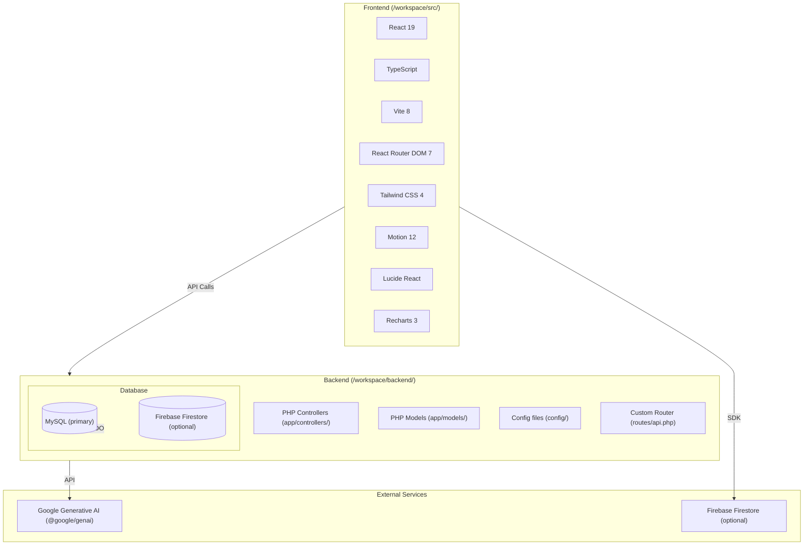
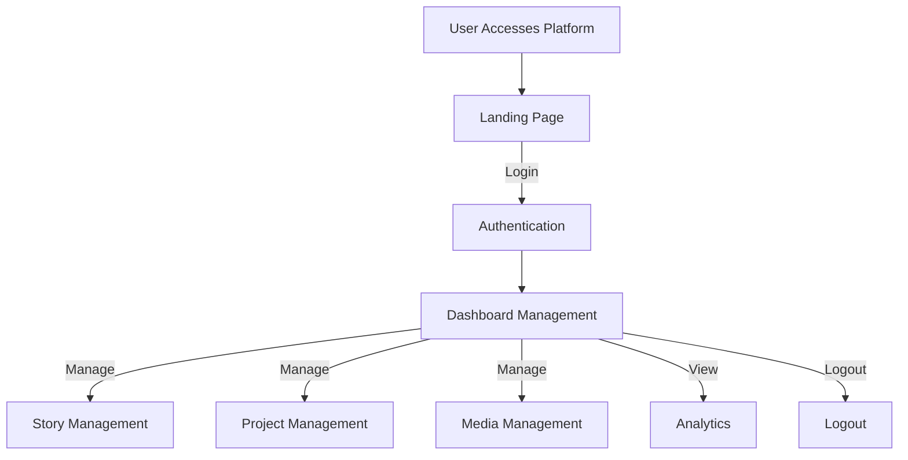

# Carita.Cerita

> **Digital platform for preserving and sharing local stories** — React + TypeScript frontend with native PHP backend, MySQL database, and Google Generative AI integration.

---

## Project Overview

| Attribute | Value |
| :--- | :--- |
| **Purpose** | Digital platform for preserving and sharing local community stories |
| **Domain** | Media / Creative Storytelling |
| **Target Users** | Local content creators, community members, and general audiences |
| **Repository** | [github.com/adicahyadir/carita_cerita](https://github.com/adicahyadir/carita_cerita) |
| **License** | MIT |

---

## Key Features

* **Landing Page**: Philosophical and values-based platform introduction.
* **Authentication**: Login system for dashboard access.
* **Dashboard Management**: Admin panel for managing various platform aspects.
* **Content Management**: Story, project, and media management.
* **Analytics**: Engagement and performance monitoring for content.
* **Frontend**: React 19 + TypeScript + Vite 8 + Tailwind CSS 4 + React Router DOM 7 + Motion + Lucide Recharts.
* **Backend**: PHP native (no framework) with PDO for database abstraction.
* **Database**: MySQL primary, Firebase Firestore optional.
* **Storage**: localStorage fallback for development.

---

## Technology Stack

### Frontend

| Technology | Version | Description |
| --- | --- | --- |
| **React** | 19.0.1 | Main UI library |
| **TypeScript** | ~5.8.2 | Type safety & DX |
| **Vite** | ^6.2.3 | Build tool & dev server |
| **React Router DOM** | ^7.14.2 | Client-side routing |
| **Tailwind CSS** | ^4.1.14 | Utility-first CSS |
| **Motion** | ^12.23.24 | Animation library (Framer Motion fork) |
| **Lucide React** | ^0.546.0 | Icon library |
| **Recharts** | ^3.8.1 | Data visualization & charts |
| **Redux Toolkit** | - | State management |

### Backend

| Technology | Version | Description |
| --- | --- | --- |
| **PHP** | 8.x | Native backend API (no framework) |
| **PDO** | - | Database abstraction layer |
| **MySQL** | - | Primary user management database |
| **Firebase Firestore** | - | Optional (ready to activate) for collection data |
| **localStorage** | - | Fallback storage for development |

### Tools & Libraries

| Technology | Description |
| --- | --- |
| **@google/genai** | Google Generative AI integration |
| **dotenv** | Environment variable management |
| **Express** | Type definitions for API types |
| **tsx** | TypeScript execution for Node.js |

---

## System Architecture



---

## Application Workflow



---

## Setup & Installation

### Prerequisites

* Node.js `^20.19.0` or `>=22.12.0`
* npm
* PHP `8.x`
* MySQL database
* Firebase project (optional, for Firestore)

### Installation

```bash
git clone https://github.com/adicahyadir/carita_cerita.git
cd carita_cerita

# 1. Install frontend dependencies
npm install

# 2. Install backend dependencies
# (Backend is native PHP; ensure PHP with PDO and extensions are available)

# 3. Configure environment
cp .env.example .env
# Fill in Firebase Web App config and database credentials

# 4. Run development
npm run dev
```

The application is available at `http://localhost:3000`.

---

## Project Status & Limitations

* **Completed**: Full-stack implementation with React frontend and native PHP backend.
* **Planned / Not Yet Implemented**: Google Drive, Sheets, and Docs integration is not configured. Managed assets are currently links only; files are not uploaded or synced to Google Drive.
* **No live demo URL** is provided in the repository documentation beyond the Netlify deployment badge.

---

## Repository

[View source code on GitHub](https://github.com/adicahyadir/carita_cerita)