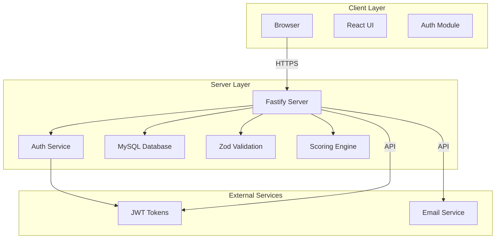
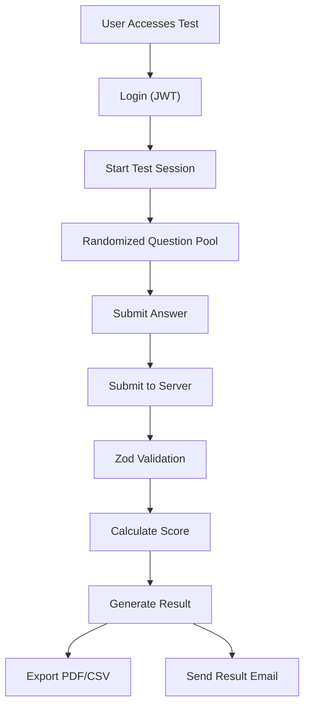

# CBT Desa — Computer Based Test (CAT Style)

> **Public examination and civil service recruitment platform** — Node.js full-stack application with real-time scoring, anti-cheat mechanisms, and cryptographic test result validation.

---

## Project Overview

| Attribute | Value |
| :--- | :--- |
| **Purpose** | Secure computer-based testing for village recruitment and public examinations |
| **Domain** | GovTech / Assessment System |
| **Target Users** | Village officials, civil servants, and examination candidates |
| **Repository** | [github.com/enigmaaura404/cbt_desa](https://github.com/enigmaaura404/cbt_desa) |
| **License** | MIT |

---

## Key Features

* **Secure Testing Environment**: Browser tab switch monitoring, anti-cheat detection, randomized question pools, and instant automated grade computation.
* **Real-time Scoring**: Live scoring during test sessions with secure server timing synchronization.
* **Cryptographic Validation**: PDF/CSV result sheets with cryptographic validation for official documentation.
* **Multi-tier Approval**: Workflow for test approval and result validation.
* **Instant Export**: Export official test result sheets in PDF/CSV format with cryptographic validation.
* **Anti-Cheating**: Real-time tab switching detection and randomized question pools.

---

## Technology Stack

| Layer | Technology | Version |
| :--- | :--- | :--- |
| **Frontend** | React | - |
| **Language** | TypeScript | - |
| **Build Tool** | Vite | 8 |
| **State Management** | Zustand | - |
| **Backend** | Node.js | - |
| **Framework** | Fastify | 5 |
| **ORM** | Prisma | - |
| **Database** | MySQL | 8+ |
| **Validation** | Zod | - |
| **Authentication** | JWT | - |
| **Testing** | Vitest | - |
| **Charts** | Recharts | 3.8.1 |
| **Icons** | Lucide React | 0.546.0 |

---

## System Architecture



---

## Application Workflow



---

## Setup & Installation

### Prerequisites

* Node.js `^20.19.0` or `>=22.12.0`
* npm
* MySQL 8+ or MariaDB 10.3+

### Installation

```bash
git clone https://github.com/enigmaaura404/cbt_desa.git
cd cbt_desa
npm install
```

### Environment Setup

Create `.env` file with required variables:
```env
DB_HOST=localhost
DB_PORT=3306
DB_NAME=cbt_desa
DB_USER=root
DB_PASSWORD=your_password
JWT_SECRET=your_jwt_secret
```

### Running

```bash
npm run dev
```

The application runs on `http://localhost:3001` (frontend) and connects to backend services.

---

## Project Status & Limitations

* **Completed**: Full-stack implementation with secure testing environment.
* **No live demo URL** is provided in the repository documentation.
* **No automated test results** are documented in the repository.

---

## Repository

[View source code on GitHub](https://github.com/enigmaaura404/cbt_desa)