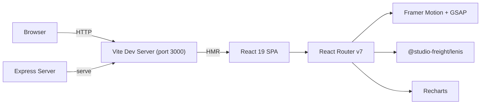

# Enigma Villa

> **Premium luxury villa booking platform** — cinematic React/TypeScript application for hospitality browsing and booking, with immersive motion design.

---

## Project Overview

| Attribute | Value |
| :--- | :--- |
| **Purpose** | Luxury villa booking platform with immersive browsing and booking experience |
| **Domain** | Hospitality / Creative Web |
| **Target Users** | Villa operators and guests browsing high-end hospitality options |
| **Repository** | [github.com/adicahyadir/enigma-villa](https://github.com/adicahyadir/enigma-villa) |
| **License** | MIT |

---

## Key Features

* **Cinematic UI/UX**: Full-screen hero sections with particle and fog animations.
* **Smooth Scrolling**: Implemented with `@studio-freight/lenis` for buttery-smooth web experience.
* **Micro-Interactions**: Magnetic buttons, custom cursors, and scroll-triggered animations via Framer Motion and GSAP.
* **Responsive Design**: Adapts from ultra-wide desktop monitors down to mobile screens.
* **Authentication UI**: Registration and login interface (built-in UI; no production backend observed in repository).
* **Admin Dashboard**: Layout for managing bookings and villas.

---

## Technology Stack

| Layer | Technology | Version |
| :--- | :--- | :--- |
| **Framework** | React | 19.0.1 |
| **Language** | TypeScript | 5.8.2 |
| **Build Tool** | Vite | 6.2.3 |
| **Styling** | Tailwind CSS | 4.1.14 |
| **Animations** | Framer Motion / Motion | 12.x |
| **Animation (alternative)** | GSAP | 3.15 |
| **Smooth Scroll** | @studio-freight/lenis | 1.0.42 |
| **Routing** | React Router DOM | 7.14.2 |
| **Charts** | Recharts | 3.8.1 |
| **Icons** | Lucide React | 0.546.0 |
| **Server** | Express | 4.21.2 |

---

## System Architecture

The application is a React SPA served by Vite in development and bundled into `dist/` for production. An Express server is included for serving the built assets or providing basic routing.



---

## Setup & Installation

### Prerequisites

* Node.js `^20.19.0` or `>=22.12.0`
* npm

### Installation

```bash
git clone https://github.com/adicahyadir/enigma-villa.git
cd enigma-villa
npm install
```

### Running Locally

```bash
npm run dev
```

The application is available at `http://localhost:3000`.

### Build

```bash
npm run build
npm run preview
```

The `dist/` output is optimized for deployment on Netlify with a `public/_redirects` file for SPA routing.

---

## Project Status & Limitations

* No production backend database is observed in the repository; the authentication and admin dashboard are UI-level implementations.
* No automated test suite observed in the repository (only `lint` via `tsc --noEmit`).
* No live demo URL is provided in the repository documentation.

---

## Repository

[View source code on GitHub](https://github.com/adicahyadir/enigma-villa)
