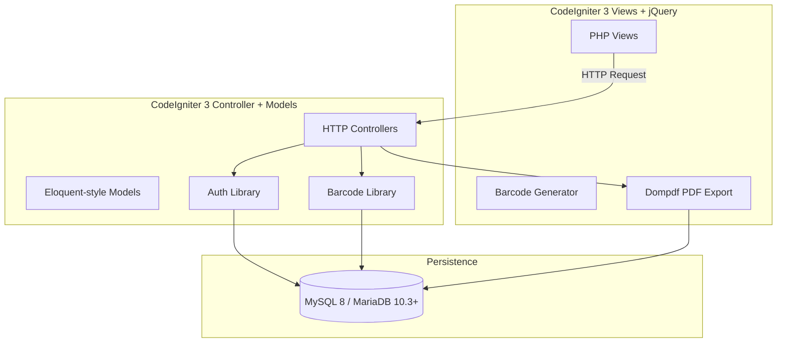

# SiPerpus — Sistem Informasi Perpustakaan Sekolah

> **School library management system** — CodeIgniter 3 + PHP 8.1+ + MySQL 8 application with multi-role authentication, barcode generation, and comprehensive circulation management.

---

## Project Overview

| Attribute | Value |
| :--- | :--- |
| **Purpose** | School library management for catalog, borrowing, returns, fines, and reporting |
| **Domain** | Education / Library Management |
| **Target Users** | Students, teachers, school librarians, and administrators |
| **Repository** | [github.com/adicahyadir/perpus](https://github.com/adicahyadir/perpus) |
| **License** | MIT |

---

## Key Features

### Public Catalog

* **Search**: By title, ISBN, barcode, author, publisher, and category.
* **Responsive**: Desktop, tablet, and mobile friendly.
* **Borrower Guidance**: Brief borrowing process guidance for visitors.

### Dashboard (Role-Based)

* **Statistics**: Title count, stock, active borrowers, borrowed books, monthly transactions, and fines.
* **Trend Charts**: 12-month transaction trend visualization.
* **Active Members**: Top active borrowers list.
* **Frequently Borrowed**: Most borrowed books list.
* **Navigation**: Permission-based menu and button visibility.

### Book Catalog Management

* **Metadata**: ISBN, title, year, pages, author, publisher, category, rack, language, and cover.
* **Cover Upload**: jpg, jpeg, png, webp with 2 MB limit.
* **Server-Side Barcode**: `BRC` prefix with cryptographic random values, CODE128 format.
* **Server-Side Book Code**: `BK` prefix with time/random components.
* **Stock Validation**: Prevents negative stock; books with borrowing history cannot be deleted (use zero stock to disable).
* **Barcode Printing**: CODE128 labels (unit or batch).

### Membership Management

* **Data**: NIS, name, gender, class, address, and phone number.
* **Synchronization**: Adding a student creates a linked account in one database transaction.
* **Sync**: NIS/name changes sync to the linked student account.
* **One-to-One**: One student account per member only.
* **Deletion Protection**: Members with borrowing history cannot be deleted.

### Circulation (Borrowing/Returning)

* **Selection**: Choose books or scan barcode.
* **Multi-Book**: Up to 3 books per transaction.
* **Transaction Code**: Server-generated (not browser-hidden).
* **No Duplicates**: Same book cannot be added twice in one transaction.
* **Atomic Stock Update**: Stock reduction/transaction saving is atomic.
* **Quick Return**: Scan barcode for fast return processing.
* **Server-Side Fine Calculation**: Based on delay policy.

### Student Portal (`/siswa`)

* **Dashboard**: Summary, active loans, history, and fines.
* **Active Loans**: Currently borrowed books and due dates.
* **History**: Returned books list.
* **Fines**: Recorded fines on completed transactions.
* **Profile**: Member data and password change.

### Reporting

* **Circulation Reports**: Monthly/yearly based on month/year.
* **Member Reports**: By class.
* **Output**: HTML ready for print and PDF via Dompdf.
* **Fine Values**: Recorded at transaction return, not accounting balance.

### Audit Log

* **Recorded Activities**: Login, logout, master ops, member, book, user, fine, circulation, backup, restore.
* **Data**: User, timestamp, IP, module, activity, record ID, and change snapshot if available.

---

## Technology Stack

| Layer | Technology | Version |
| :--- | :--- | :--- |
| **Framework** | CodeIgniter 3 | - |
| **Language** | PHP | 8.1/8.2+ |
| **Database** | MySQL 8 or MariaDB 10.3+ | - |
| **Frontend** | Responsive UI | - |
| **Authentication** | Multi-role | - |
| **Barcode** | CODE128 format | - |
| **PDF Generation** | Dompdf | - |
| **Excel Export** | - | - |
| **Testing** | - | - |
| **Deployment** | Production environment configuration | - |

---

## System Architecture



---

## Setup & Installation

### Prerequisites

* PHP `8.1/8.2+`
* Composer (for CodeIgniter)
* MySQL 8 or MariaDB 10.3+
* Web server (Apache or Nginx)

### Installation

```bash
git clone https://github.com/adicahyadir/perpus.git
cd perpus

# 1. Install dependencies (if any composer-managed)
composer install

# 2. Configure environment
cp .env.example .env

# 3. Generate application key
php artisan key:generate  # Or CodeIgniter: php spark generate-key

# 3. Run migrations / setup database
# (CodeIgniter typically uses database.php config)

# 4. Start development server
# Apache/Nginx pointing to public/ directory, or:
php -S localhost:8000 -t public
```

> **Status**: Production-ready candidate. Before go-live, administrator must run migration on the target database, configure production settings, activate HTTPS, and complete the deployment checklist.

---

## Project Status & Limitations

* **Status**: Production-ready candidate. Before go-live, administrator must run migration on the target database, configure production settings, activate HTTPS, and complete the deployment checklist.
* No automated test suite results are documented in the repository.
* No live demo URL is provided in the repository documentation.

---

## Repository

[View source code on GitHub](https://github.com/adicahyadir/perpus)