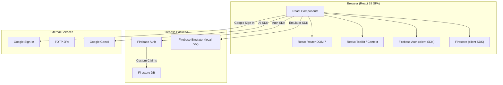
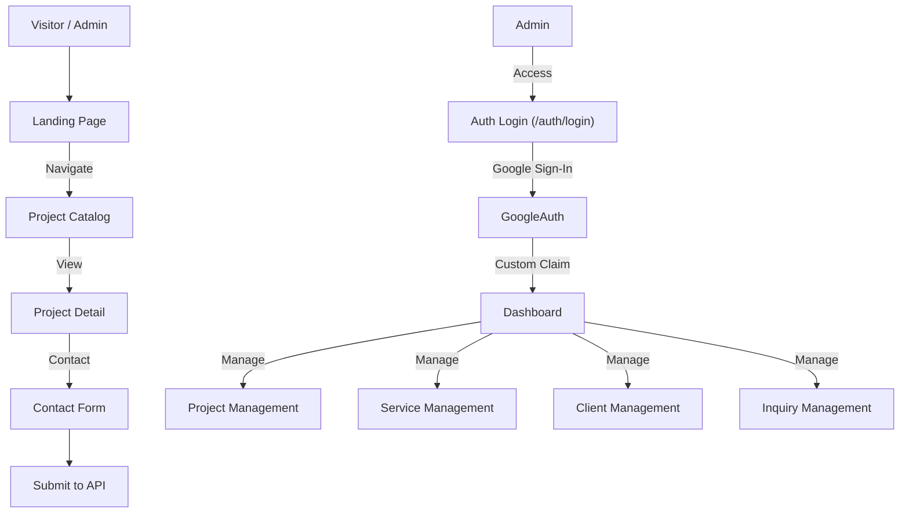

# Portfolio Evan

> **Personal portfolio website** — React 19 + TypeScript application showcasing interior design projects, 3D visualizations, services, and contact functionality with private admin dashboard.

---

## Project Overview

| Attribute | Value |
| :--- | :--- |
| **Purpose** | Personal portfolio website for interior designer Evan Yasri G |
| **Domain** | Personal Portfolio / Creative Web |
| **Target Users** | Potential clients, design enthusiasts, and general visitors |
| **Repository** | [github.com/adicahyadir/porfolio_evan](https://github.com/adicahyadir/porfolio_evan) |
| **License** | MIT |

---

## Key Features

### Public Portfolio

* **Home, Profile, Services, and Project Catalog**: Main navigation pages with responsive design.
* **Project Detail and Image Gallery**: Individual project showcases with visual galleries.
* **Contact Form**: For project inquiries.
* **Responsive Design**: Optimized for desktop and mobile devices.

### Admin Dashboard (Private)

* **Project, Service, Client, and Inquiry Management**: Full content management capabilities.
* **Link Asset Management**: Management of external asset links.
* **Draft Invoice Management**: Draft invoices stored and managed.
* **Billing Configuration**: Billing item and settings management.
* **Google Sign-In and 2FA (TOTP)**: Firebase Authentication with custom claims and Firestore Security Rules.
* **Dashboard Access**: Restricted by custom claims and Firestore rules; accessible only by typing the URL directly (no admin button in public navigation).

> [!NOTE]
> Google Drive, Sheets, and Docs integration is not configured. Managed assets are currently links only; files are not uploaded or synced to Google Drive. Invoices are saved as drafts and not sent automatically.

---

## Technology Stack

| Layer | Technology | Version |
| :--- | :--- | :--- |
| **Framework** | React | 19.0.1 |
| **Language** | TypeScript | ~5.8.2 |
| **Build Tool** | Vite | 8.3.0 |
| **Styling** | Tailwind CSS | 4.1.14 |
| **Routing** | React Router DOM | 7.14.2 |
| **Charts** | Recharts | 3.8.1 |
| **Icons** | Lucide React | 0.546.0 |
| **Authentication** | Firebase Authentication | - |
| **Database** | Cloud Firestore | - |
| **State Management** | Redux Toolkit | - |
| **Emulator** | Firebase Emulator | - |
| **AI Integration** | @google/genai | - |
| **Express** | Express (for emulator) | 4.21.2 |
| **QR Code** | qrcode.react | 4.2.0 |
| **Motion** | Motion | 12.23.24 |

---

## System Architecture



---

## Application Workflow



---

## Setup & Installation

### Prerequisites

* Node.js `^20.19.0` or `>=22.12.0`
* npm
* Firebase project for authentication and database features

### Installation

```bash
git clone https://github.com/adicahyadir/porfolio_evan.git
cd porfolio_evan
npm install
```

### Environment Configuration

Copy `.env.example` to `.env` and configure Firebase Web App credentials:

```dotenv
VITE_FIREBASE_API_KEY="your-firebase-web-api-key"
VITE_FIREBASE_AUTH_DOMAIN="your-project.firebaseapp.com"
VITE_FIREBASE_PROJECT_ID="your-project-id"
VITE_FIREBASE_APP_ID="your-firebase-app-id"
VITE_SUPERADMIN_EMAIL="your-verified-admin-email@example.com"
```

> [!IMPORTANT]
> Firebase API key is not a substitute for security rules: restrict key access via Google Cloud Console and configure Firestore Security Rules. Do not insert service-account key or secret credentials into `VITE_` variables or commit to the repository.

### Running Development

```bash
npm run dev
```

The application is available at `http://localhost:3000`.

### Emulator Mode (Local Audit)

```bash
# Start all emulators (requires Java)
npm run emulators

# Start UI in emulator mode
npm run dev:emulator
```

Open `http://localhost:3000/auth/login`. Google Sign-In uses the local Auth Emulator. Test accounts: `admin@evan-porto.test`.

### Build & Preview

```bash
npm run build
npm run preview
```

---

## Project Status & Limitations

* **Completed**: Full portfolio website with public pages and private admin dashboard.
* **Planned / Not Yet Implemented**: Google Drive, Sheets, and Docs integration (not configured; assets are links only).
* **No live demo URL** is provided in the repository documentation beyond the deployed site at `adicahyadir.dev`.

---

## Repository

[View source code on GitHub](https://github.com/adicahyadir/porfolio_evan)