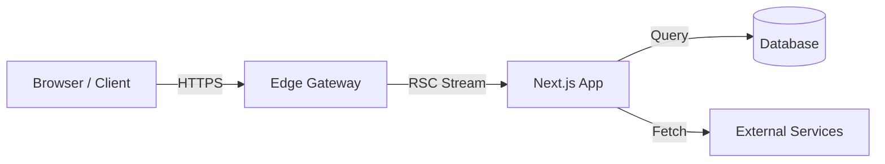

# Project Documentation Template (RFC)

> **Instructions for Authors:**  
> Use this template whenever adding or documenting a new project in the **ACR Ecosystem**. Copy this file, rename it to your project slug (e.g. `projects/my-new-app.md`), and fill out all sections completely.

---

## [Project Title]

<p align="center">
  <strong>[One-line elevator pitch or tagline describing the product]</strong>
</p>

---

## 🎯 1. Overview

* **Purpose:** [What does this application do? Why does it exist?]
* **Problem Solved:** [What specific engineering, business, or user pain point does this resolve?]
* **Target Users:** [Who is the primary audience or consumer of this tool?]
* **Live Deployment:** [URL to production application, e.g. https://...]
* **Source Code:** [URL to GitHub repository]

---

## ✨ 2. Major Features

* **[Feature 1]:** [Detailed description of capabilities and user benefits]
* **[Feature 2]:** [Detailed description of capabilities and user benefits]
* **[Feature 3]:** [Detailed description of capabilities and user benefits]
* **[Feature 4]:** [Detailed description of capabilities and user benefits]

---

## 🛠️ 3. Technology Matrix

| Layer | Technology | Rationale |
| :--- | :--- | :--- |
| **Frontend** | React / Next.js / TypeScript | High-performance rendering, strong typing. |
| **Styling** | Tailwind CSS / Framer Motion | Rapid tokenized layout and physics motion. |
| **Backend** | Route Handlers / Node.js | Lightweight serverless compute. |
| **Database** | PostgreSQL / Supabase | Relational integrity and edge support. |
| **Cache** | Upstash Redis | Fast KV caching and rate limiting. |
| **Hosting** | Vercel / Cloudflare | Global CDN edge propagation. |

---

## 🏛️ 4. Architecture & Data Flow

### Folder Layout

```text
[project-name]/
├── src/
│   ├── app/              # Routes and pages
│   ├── components/       # UI and domain components
│   ├── lib/              # Database clients, utilities
│   └── types/            # TypeScript domain interfaces
├── public/               # Static assets
└── package.json
```

### Component & System Diagram



---

## 🚀 5. Installation & Local Development

### System Requirements

* Node.js `>= 18.17.0`
* npm `>= 9.0.0` or pnpm `>= 8.0.0`

### Installation Steps

```bash
# 1. Clone repository
git clone https://github.com/adicahyadir/[project-slug].git
cd [project-slug]

# 2. Install dependencies
npm install

# 3. Configure environment variables
cp .env.example .env.local

# 4. Start local development server
npm run dev
```

### Environment Configuration (`.env.local`)

| Variable | Required | Default | Description |
| :--- | :--- | :--- | :--- |
| `DATABASE_URL` | Yes | - | PostgreSQL connection string pool. |
| `NEXTAUTH_SECRET` | Yes | - | Secret key used to encrypt session tokens. |
| `NEXTAUTH_URL` | Yes | `http://localhost:3000` | Canonical origin of the web application. |
| `NEXT_PUBLIC_API_URL` | No | `/api` | Public base path for client-side fetches. |

---

## 📡 6. API & Integration Reference

### Key Endpoint Example

`GET /api/v1/[resource]`

#### Request Headers
```http
Content-Type: application/json
Authorization: Bearer <token>
```

#### Response `200 OK`
```json
{
  "status": "success",
  "data": {
    "id": "item_123",
    "name": "Sample Entity"
  }
}
```

---

## 🧪 7. Testing & Verification

```bash
# Run unit & integration test suite
npm run test

# Run end-to-end browser tests
npm run test:e2e

# Run linter and type-checker
npm run lint
npm run typecheck
```
