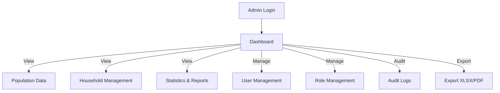

# Sistem Informasi Kependudukan

> **Village population administration system** — React 19 + TypeScript frontend with Fastify 5 backend, MySQL 8 database, and comprehensive RBAC with audit logging.

---

## Project Overview

| Attribute | Value |
| :--- | :--- |
| **Purpose** | Village population administration with population data, household management, and statistical reporting |
| **Domain** | GovTech / Public Administration |
| **Target Users** | Village officials, civil servants, and local government administrators |
| **Repository** | [github.com/enigmaaura404/sistem-informasi-kependudukan](https://github.com/enigmaaura404/sistem-informasi-kependudukan) |
| **License** | MIT |

---

## Key Features

* **Population & Household Management**: Resident data, household composition, and family relationships.
* **Geospatial Management**: Dusun/RW/RT administrative divisions with GIS integration.
* **Data Import**: XLSX/CSV import with staging validation and error reporting.
* **Dashboard & Analytics**: Recharts-based statistics on population metrics, transaction trends, and demographic data.
* **RBAC & Audit Logging**: Role-based access control with detailed audit trails for all operations.
* **Validation & Quality Control**: Zod schema validation, Argon2 password hashing, and ExcelJS data integrity checks.
* **Migration System**: Two SQL scripts (database_master.sql and migration.sql) for baseline and versioned schema updates.
* **Security**: MySQL 8+ with CHECK constraints and JSON support, HTTPS requirement for production, and strong authentication secrets.

---

## Technology Stack

| Layer | Technology | Version |
| :--- | :--- | :--- |
| **Frontend** | React 19 + TypeScript | - |
| **Build Tool** | Vite 8 | - |
| **Styling** | Tailwind CSS 4 | - |
| **Charts** | Recharts | - |
| **Backend** | Fastify 5 | - |
| **Language** | TypeScript | - |
| **ORM** | Prisma (implied) | - |
| **Database** | MySQL 8 or MariaDB | - |
| **Validation** | Zod | - |
| **Password Hashing** | Argon2 | - |
| **Excel** | ExcelJS | - |
| **Testing** | npm test | - |
| **Deployment** | npm run build + npm --prefix backend start | - |

---

## System Architecture

```mermaid
flowchart TD
    subgraph Frontend["Frontend (src/ and public/)"]
        React["React 19"]
        TS["TypeScript"]
        Vite["Vite 8"]
        Tailwind["Tailwind CSS 4"]
        Recharts["Recharts"]
    end

    subgraph Backend["Backend (backend/src/)"]
        Fastify["Fastify 5"]
        MySQL["MySQL 8"]
        Zod["Zod Validation"]
        Argon2["Argon2 Password Hashing"]
        Excel["ExcelJS"]
    end

    subgraph API["API Layer"]
        API["/api/v1 endpoints"]
    end

    Frontend -->|VITE_API_BASE_URL=/api/v1| Backend
    Backend -->|MySQL| Database["MySQL 8"]
    Backend -->|Zod| Validation
    Backend -->|Argon2| Password["Password Hashing"]
    Backend -->|ExcelJS| Data["Data Import/Export"]
```

---

## Application Workflow



---

## Setup & Installation

### Prerequisites

* Node.js 24 LTS
* npm
* MySQL 8 or MariaDB
* Node.js 24 LTS

### Installation

```powershell
# Frontend setup
npm ci
npm --prefix backend ci
Copy-Item .env.example .env
Copy-Item backend/.env.example backend/.env
```

### Environment Configuration

Frontend uses `VITE_API_BASE_URL=/api/v1` to communicate with backend. Backend reads `backend/.env` for database and authentication configuration.

### Database Setup

```powershell
# Set MySQL password for database operations
$env:MYSQL_PWD = '<password-administrator-database>'

# Initialize production database
./scripts/init-production-db.ps1 -Database db_kependudukan -ConfirmDatabaseName db_kependudukan

# Remove temporary password variable
Remove-Item Env:MYSQL_PWD
```

### Running Application

```powershell
# Start backend in watch mode
npm run dev:backend

# Start frontend in watch mode
npm run dev

# Run tests
npm test

# Run backend tests
./scripts/test-backend.ps1 -Database db_kependudukan_test
```

### Deployment

Build with `npm run build` and `npm run build:backend`. Start production backend with `npm --prefix backend start`.

---

## User Roles

* **SUPERADMIN**: Full system management
* **SEKDES**: Operational authority (Kecamatan level)
* **KASI_PEMERINTAHAN**: Operational authority (Regency level)
* **KADUS**: Dusun-level administrative access
* **KEPALA_DESA**: Dashboard and reporting access only

---

## Troubleshooting

* **API 503**: Check backend port 3001 and database connection; verify `/api/v1/health` endpoint returns database connected status.
* **Boot rejected**: Verify `backend/.env` configuration and production settings; do not use template secrets in production.
* **Login rejected**: Verify account provisioning, activation status, and role/scope assignment.
* **Deep link 404**: Configure reverse proxy with SPA fallback.
* **Import failure**: Use XLSX/CSV format, validate column mapping, and check staging environment for errors.

---

## Documentation Index

* [Route Structure](PROJECT_STRUCTURE.md)
* [Database Schema](DATABASE.md)
* [RBAC Configuration](RBAC.md)
* [Development Guide](DEVELOPMENT.md)
* [Deployment Guide](DEPLOYMENT.md)

---

## Repository

[View source code on GitHub](https://github.com/enigmaaura404/sistem-informasi-kependudukan)