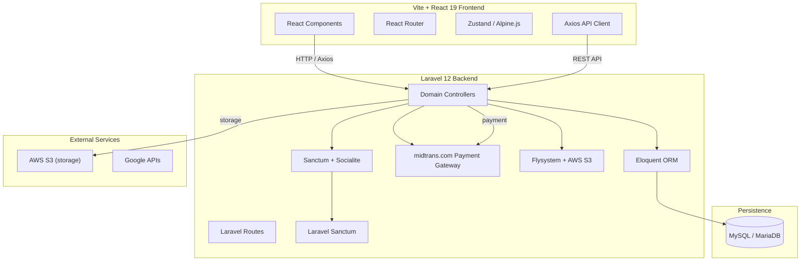

# Temen Musik

> **Laravel 12 marketplace for musical instruments, artists, and studio booking** — full e-commerce, escrow payments, reservations, and payout system.

---

## Project Overview

| Attribute | Value |
| :--- | :--- |
| **Purpose** | Marketplace for musical instruments, artist profiles, and studio booking with escrow and payout system |
| **Domain** | Creative Web / E-commerce |
| **Target Users** | Musicians, instrument buyers, studio owners, administrators, and superadmins |
| **Repository** | [github.com/enigmaaura404/temen_musik](https://github.com/enigmaaura404/temen_musik) |
| **License** | MIT |

---

## Key Features

* **Full E-commerce**: Catalog, shopping cart, checkout, and payment processing.
* **Artist & Studio Profiles**: Separate portfolios for sellers and studios.
* **Booking & Reservations**: Studio or instrument booking with date/conflict detection.
* **Escrow Payment System**: Secure payment holding until fulfillment.
* **Payout System**: Revenue distribution to sellers/artists.
* **Complaint/Return System**: Verified complaints and return processing.
* **Verified Reviews**: User reviews with verification status.
* **Admin Operational Audit**: Full operational oversight and audit capabilities.

---

## Technology Stack

| Layer | Technology | Version |
| :--- | :--- | :--- |
| **Framework** | Laravel | 12.61.1 |
| **Language** | PHP | 8.2+ |
| **Frontend** | Vite + React 19 + TypeScript | - |
| **Styling** | Tailwind CSS | 3.4.19 |
| **Build Tool** | Vite | 7.3.1 |
| **State Management** | Zustand / Alpine.js | - |
| **HTTP Client** | Axios | 1.19.0 |
| **Utility** | lodash | 4.17.21 |
| **Payment** | midtrans/midtrans-php | 2.6 |
| **Alert** | realrashid/sweet-alert | 7.0 |
| **PDF/Markdown** | league/commonmark | 2.9 |
| **S3 Storage** | league/flysystem-aws-s3-v3 | 3.25.1 |
| **Authentication** | Laravel Sanctum | 4.0 |
| **Social Login** | Laravel Socialite | 5.12 |
| **Testing** | PHPUnit | 11.0 |
| **Linting** | Laravel Pint | - |

---

## System Architecture



---

## Setup & Installation

### Prerequisites

* PHP `8.2+`
* Composer
* Node.js `^20.19.0` or `>=22.12.0`
* npm
* MySQL 8+ or MariaDB

### Installation

```bash
git clone https://github.com/enigmaaura404/temen_musik.git
cd temen_musik

# 1. Install PHP dependencies
composer install

# 2. Install frontend dependencies
npm install

# 3. Configure environment
cp .env.example .env
php artisan key:generate

# 4. Run migrations and seeders
php artisan migrate --seed

# 5. Start development
composer dev
```

The `composer dev` script runs `php artisan serve`, queue listener, pail log watcher, and Vite concurrently.

---

## Project Status & Limitations

* No explicit status or roadmap is documented in the repository README.
* No automated test suite results are documented in the repository.
* No live demo URL is provided in the repository documentation.

---

## Repository

[View source code on GitHub](https://github.com/enigmaaura404/temen_musik)